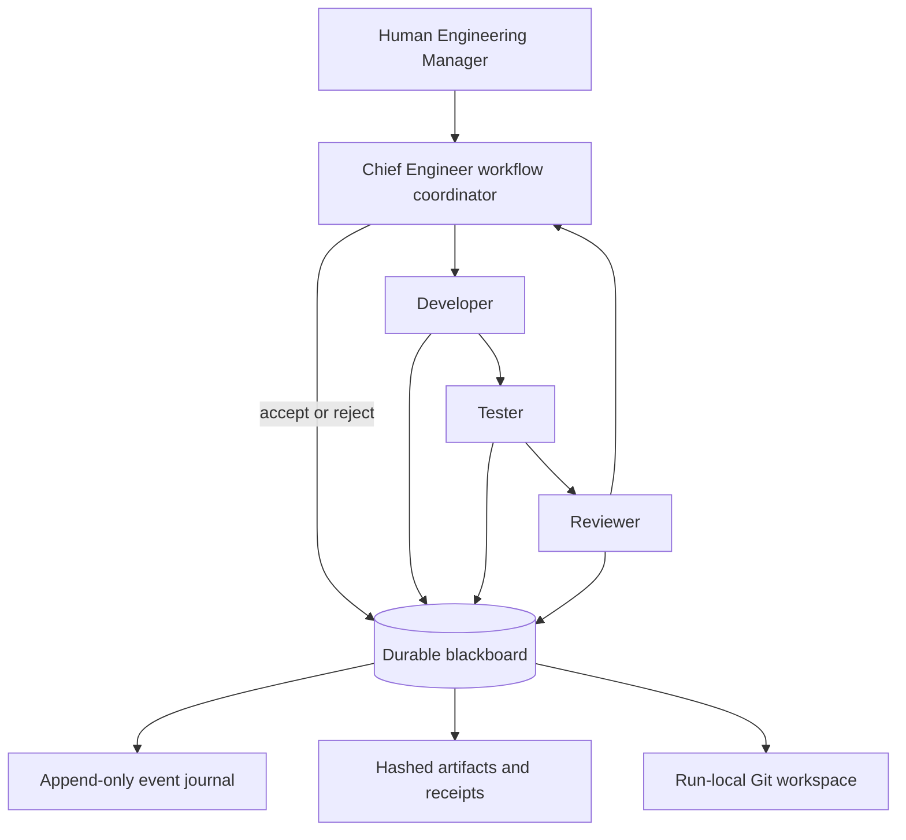
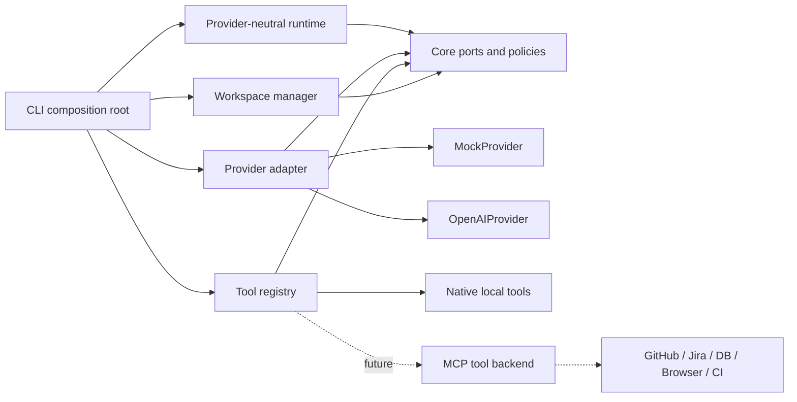
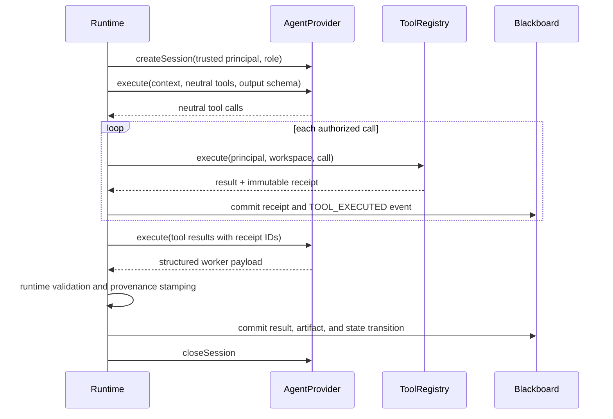
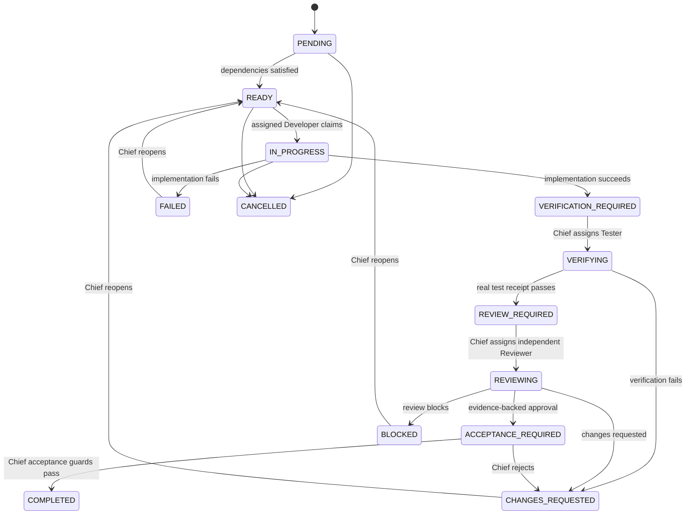

# Architecture

## Organizational model

The human supplies an objective. V0's Chief Engineer deterministically creates one task, assigns it, coordinates verification and review, enforces acceptance guards, completes the objective, and writes a final report. The decomposition seam produces a validated task graph; the included scenario has one task with no dependencies.

Workers do not need unconstrained peer-to-peer conversation. They read a scoped execution context and return structured payloads to shared state. The runtime—not the provider—stamps run, objective, task, agent, and role provenance.

## Execution architecture

`@agent-org/runtime` has no dependency on `@agent-org/providers`, `@agent-org/tools`, or a provider SDK. The CLI is the only composition root and injects implementations through core interfaces.

## Neutral provider loop

Each execution has maximum turns, maximum tool calls, and a duration limit. Provider capabilities are checked before session creation.

## Task lifecycle

One reducer is the task mutation path. Guards validate trusted actor scope, role authority, immutable assignments, structured result provenance, independent verification/review, real receipt ownership, Git evidence, criterion coverage, and valid state transitions.

Objectives have their own lifecycle. Only the Chief Engineer can complete one, every referenced task must be `COMPLETED`, and no human approval may remain pending.

## Blackboard and durability

The filesystem blackboard stores an authoritative `events.jsonl` journal. Each line contains:

- a monotonic revision and previous revision;
- one domain event;
- the resulting ledger state;
- a SHA-256 hash of that state.

`ledger.json` is an atomically replaced cache of the latest valid journal state. Loading validates every revision and hash, then repairs a missing or stale snapshot. This is a small write-ahead journal, not a general event-sourcing framework.

Reports are immutable content-addressed artifacts. Tool receipts record trusted provenance, input, bounded output, timestamps, status, working directory, exit code, and file hashes where applicable. Agent-run records capture provider, model, duration, usage, receipt IDs, status, and errors.

## Verification and acceptance

The tester's `PASS` is insufficient by itself. The domain requires a successful `shell.execute` receipt owned by the assigned tester. Likewise, reviewer `APPROVE` requires a successful, non-empty `git.diff` receipt owned by an agent other than the implementer. Final acceptance checks that both records belong to the task, reference known receipts, and cover every acceptance criterion.
