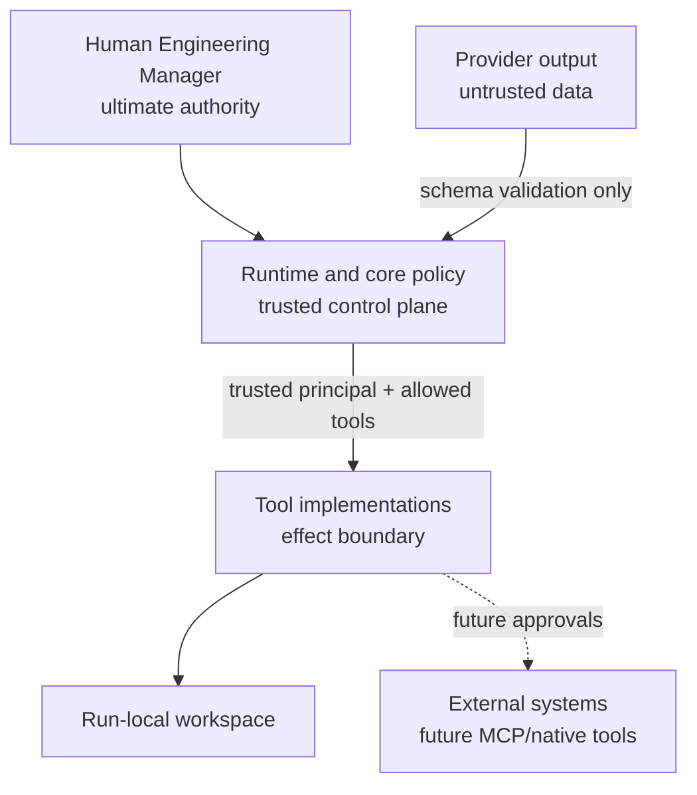

# Security model

## Trust boundaries

The runtime, core authorization/state logic, storage integrity checks, and configured tool implementations form V0's trusted computing base. Provider output is untrusted, even when it is schema-valid.

## Identity and separation of duties

Providers do not supply authoritative run, task, agent, reviewer, or role identity. The runtime creates an immutable `ActorPrincipal`, scopes it to one run/objective/task, and stamps durable result envelopes itself.

The domain rejects:

- a result whose provenance conflicts with the current execution;
- verification by the implementation agent;
- review by the implementation agent;
- review evidence owned by another actor;
- acceptance without the recorded independent verification and review.

Declarative action permissions are machine-readable and checked before organizational actions. Descriptive `may` and `may_not` text is documentation, not a substitute for those enums.

## Tool controls

Filesystem tools reject absolute paths, lexical traversal, and resolved junction/symlink escapes. Writes check the nearest existing real parent and reject symbolic-link targets. File reads and writes can emit SHA-256 hashes.

`shell.execute` does not accept a command line. It accepts a configured command-template ID, then launches a fixed executable and argument vector with `shell: false`, a fixed real working directory, a scrubbed environment, timeout, hidden Windows process, and bounded output. Git status and diff also use fixed arguments.

Every attempted tool call creates a trusted receipt, including failures. Role tool allowlists are checked before tool lookup.

These controls are application-layer least privilege, **not an operating-system sandbox**. An approved executable can still exploit its own capabilities, access resources available to the current user, or behave maliciously. Untrusted repositories and commands require a future container, VM, restricted user, or comparable isolation boundary.

## Evidence integrity

Artifacts are addressed and verified by SHA-256. Final acceptance re-verifies every stored workflow artifact. The event journal stores a monotonic revision chain and state hash; revision gaps, malformed entries, or mismatches fail closed. A stale snapshot is derived and repaired from the journal.

The journal is tamper-evident within one run, not externally notarized. A user with write access to the repository can rewrite the entire state directory and code. Future high-assurance deployments should use signed records or an append-only external store.

## Secrets

The OpenAI key is loaded only by the CLI composition root when the OpenAI provider is selected. Environment variables are not forwarded wholesale into approved child commands. Error recording redacts common API-key shapes, and events record tool metadata rather than full outputs.

V0 does not implement a general secret manager. Provider adapters and future tools must accept secret references through the composition boundary and must never place plaintext secrets in prompts, ledgers, events, receipts, artifacts, or source control.

## Human approval

Core includes a generic durable `ApprovalRequest` with pending, approved, and denied states. Only an `ENGINEERING_MANAGER` principal can resolve one, and pending approvals prevent objective completion.

The V0 demo does not trigger an approval gate. It does not merge, deploy, migrate a database, modify secrets, delete infrastructure, perform destructive filesystem operations, or authorize high-cost activity. Future implementations of those actions must request and verify approval before effect execution—not merely record approval afterward.

## Known limitations

- No OS-level sandbox or resource quota beyond per-command time/output bounds.
- No authentication system around the local CLI or state directory.
- No cryptographic signatures or remote audit-log durability.
- No cost ceiling or interactive approval command for live model usage.
- No automatic provider diversity or risk-based routing.
- No MCP server trust policy yet.
- The OpenAI live adapter can behave nondeterministically and incur cost; ordinary tests use fake clients and MockProvider.
